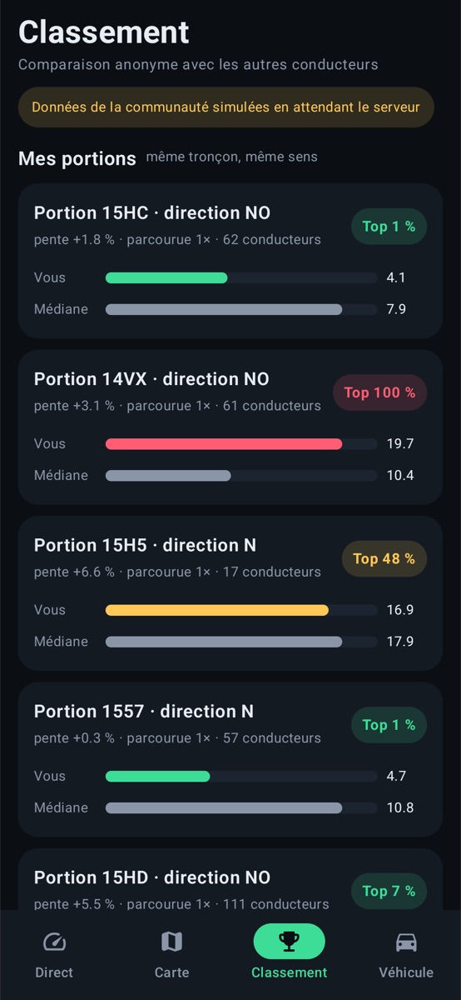

# EcoDrive OBD

App Android qui mesure en temps réel la consommation d'une voiture via un module OBD-II Bluetooth (ELM327), et note l'éco-conduite **en tenant compte du dénivelé**.

<p>
  
  
  
  
  
</p>

## Fonctionnalités

- **Consommation instantanée et moyenne** (L/100 km, L/h à l'arrêt), lue par OBD-II : débit carburant (PID 5E), sinon débitmètre d'air (PID 10), sinon pression collecteur (PID 0B).
- **Éco-score tenant compte du relief** : la consommation réelle est comparée à celle attendue par un modèle physique (masse, roulement, aérodynamique) selon la vitesse et la pente. Une montée n'est pas pénalisée ; accélérer en descente, si.
- **Relief** par baromètre du téléphone, ou modèle de terrain [Open-Meteo](https://open-meteo.com/en/docs/elevation-api) (Copernicus 90 m) quand le téléphone n'en a pas.
- **Graphe du trajet** coloré par éco-score, navigable, moyenné selon la fenêtre affichée.
- **Carte des surconsommations** (OpenStreetMap), agrégée par route, et détail par jour.
- **Classement** anonyme par portion de route et par modèle équivalent (données de communauté simulées pour l'instant).
- **Trajet conservé tant que le moteur tourne** (PID 1F), même si l'app redémarre.
- **Démarrage automatique** à la connexion Bluetooth de la voiture.
- **Android Auto** (Car App Library, catégorie IoT).

## Construire

JDK 17 et Android SDK 36 requis.

```bash
./gradlew assembleDebug
./gradlew testDebugUnitTest
```

Un **simulateur ELM327** intégré (bouton *Connecter* → *Simulateur*) répond en vraies trames OBD : l'app est testable sur émulateur, sans voiture.

## Android Auto

En voiture, Android Auto n'affiche une app Car App Library que si elle vient d'une source de confiance (Google Play, piste de test interne). Pour développer, utiliser le [Desktop Head Unit](https://developer.android.com/training/cars/testing/dhu).
