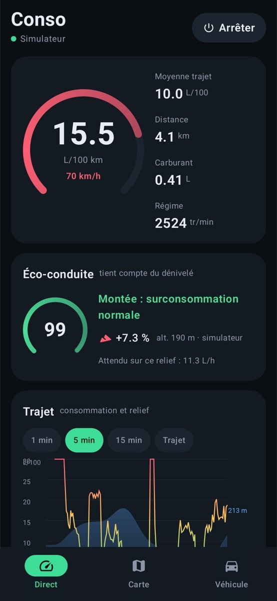
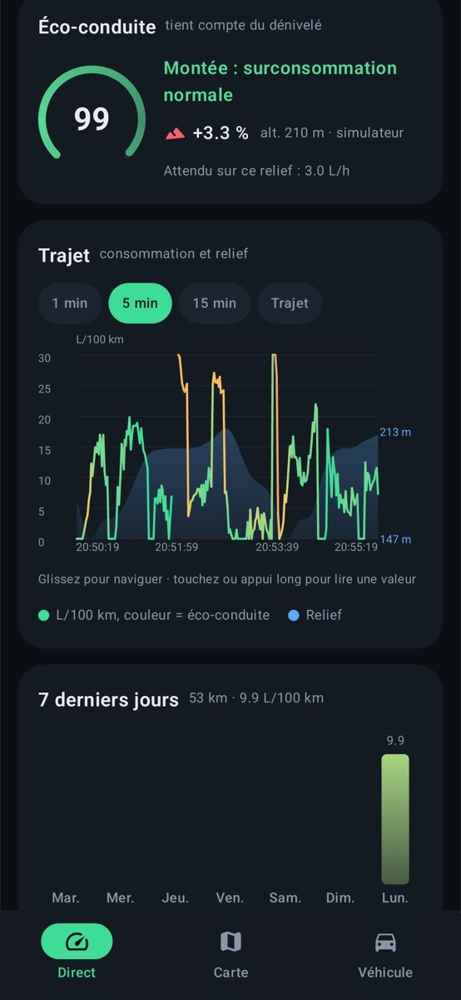
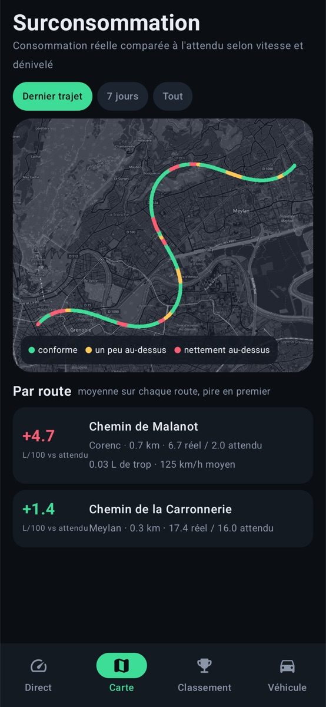
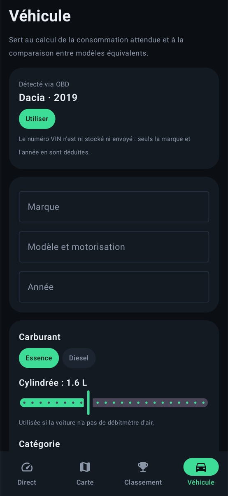

# EcoDrive OBD

Android app that measures a car's fuel consumption in real time through a Bluetooth OBD-II module (ELM327), and scores eco-driving **while accounting for road gradient**.

<p>
  
  
  
  
</p>

The app UI is in French.

## Features

- **Instant and average consumption** (L/100 km, L/h when stopped), read over OBD-II: fuel rate (PID 5E), otherwise mass air flow (PID 10), otherwise manifold pressure (PID 0B).
- **Gradient-aware eco score**: actual consumption is compared with the consumption expected by a physical model (mass, rolling resistance, aerodynamics) for the current speed and slope. Climbing is not penalised; accelerating downhill is.
- **Elevation** from the phone's barometer, or from the [Open-Meteo](https://open-meteo.com/en/docs/elevation-api) terrain model (Copernicus 90 m) when the phone has none.
- **Trip chart** coloured by eco score, scrollable, averaged according to the displayed time window.
- **Over-consumption map** (OpenStreetMap), aggregated per road, with a per-day detail view.
- **Trip kept while the engine runs** (PID 1F), even if the app restarts.
- **Auto-start** when the phone connects to the car over Bluetooth.
- **Android Auto** (Car App Library, IoT category).

## Build

Requires JDK 17 and Android SDK 36.

```bash
./gradlew assembleDebug
./gradlew testDebugUnitTest
```

A built-in **ELM327 simulator** (*Connecter* → *Simulateur*) answers with real OBD frames, so the app can be tested on an emulator without a car.

## Android Auto

In a real car, Android Auto only shows Car App Library apps installed from a trusted source (Google Play, internal test track). For development, use the [Desktop Head Unit](https://developer.android.com/training/cars/testing/dhu).
