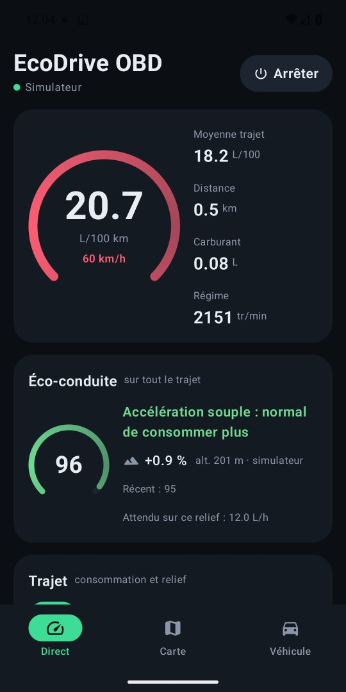
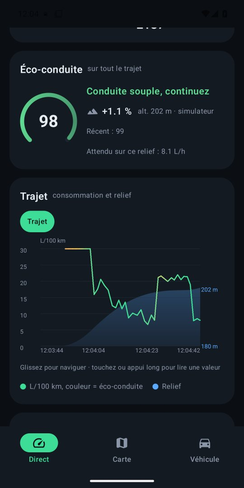
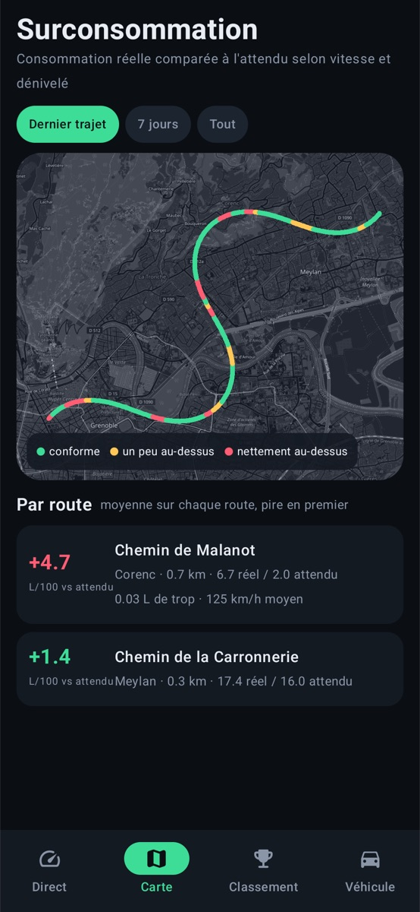
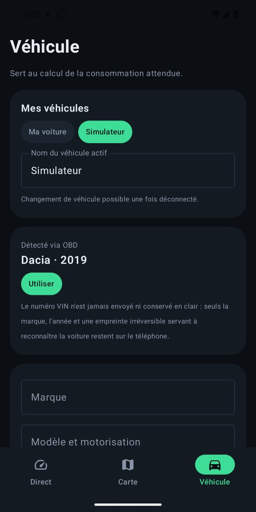

# EcoDrive OBD

Android app that measures a car's fuel consumption in real time through a Bluetooth OBD-II module (ELM327), and scores eco-driving **while accounting for road gradient**.

<p>
  
  
  
  
</p>

The app UI is in French.

## Features

- **Instant and average consumption** (L/100 km, L/h when stopped), read over OBD-II: fuel rate (PID 5E), otherwise mass air flow (PID 10), otherwise manifold pressure (PID 0B).
- **Gradient-aware eco score**: actual consumption is compared with the consumption expected by a physical model (mass, rolling resistance, aerodynamics) for the current speed and slope. Climbing is not penalised; accelerating downhill is.
- **Elevation** from the phone's barometer, or from the [Open-Meteo](https://open-meteo.com/en/docs/elevation-api) terrain model (Copernicus 90 m) when the phone has none.
- **Trip chart** coloured by eco score, scrollable, averaged according to the displayed time window.
- **Over-consumption map** (OpenStreetMap), aggregated per road, with a per-day detail view.
- **Trip kept while the engine runs** (PID 1F), even if the app restarts.
- **Auto-start** when the phone connects to the car over Bluetooth (without GPS while the app is not on screen: the app never asks for background location).

## Build

Requires JDK 17 and Android SDK 36.

```bash
./gradlew assembleDebug
./gradlew testDebugUnitTest
```

A built-in **ELM327 simulator** (*Connecter* → *Simulateur*) answers with real OBD frames, so the app can be tested on an emulator without a car.

## Release

Google Play takes an Android App Bundle (`.aab`) signed with the app's **upload key**. Play keeps the app signing key (Play App Signing) and re-signs what it distributes. Keystores, passwords and service account keys never go in this repository, a commit or a log.

### Version numbers

- `versionCode` is the number of commits reachable from `HEAD`: it grows with every merge into `main`. In a shallow clone, pass `VERSION_CODE` or clone in full.
- `versionName` is the latest `vX.Y.Z` tag without the `v` (`git tag v1.2.0` gives 1.2.0), `0.1.0` without a tag.
- `VERSION_CODE` and `VERSION_NAME` override the computed values. The very first bundle, uploaded by hand, goes out with `VERSION_CODE=1`.

### Signed build

```bash
export UPLOAD_KEYSTORE_PATH=/path/to/upload.keystore
export UPLOAD_KEYSTORE_PASSWORD=... UPLOAD_KEY_ALIAS=... UPLOAD_KEY_PASSWORD=...
./gradlew :app:bundleRelease
```

Output: `app/build/outputs/bundle/release/app-release.aab`. Without the four `UPLOAD_*` variables the release is built unsigned and debug builds are unaffected; with only some of them, the build fails.

### Publish to Play

`scripts/play-publish.sh` builds the signed bundle and uploads it with [Gradle Play Publisher](https://github.com/Triple-T/gradle-play-publisher):

```bash
scripts/play-publish.sh            # internal track, as a draft
scripts/play-publish.sh alpha      # closed testing
scripts/play-publish.sh internal --release-status completed --listing
MICKA_APPROVED_ISSUE=ECO-123 scripts/play-publish.sh production
```

- Secrets are read from the environment: `ECODRIVE_UPLOAD_KEYSTORE_B64` (keystore in base64), `ECODRIVE_UPLOAD_KEYSTORE_PASSWORD`, `ECODRIVE_UPLOAD_KEY_ALIAS`, `ECODRIVE_UPLOAD_KEY_PASSWORD` and `PLAY_SERVICE_ACCOUNT_JSON` (content of the service account key). The script writes them to a private temporary directory, deleted on exit, and never prints them.
- `beta` (open testing) and `production` are public: the script refuses them without `MICKA_APPROVED_ISSUE`, the task that carries the maintainer's written approval. This is a procedural guard, not a technical control: the script only checks that the value looks like a task identifier, not that the approval exists, and makes no network call. The real lock is that only the CTO holds the Play service account key, and that `beta` and `production` uploads require the owner's written approval on the task named there.
- `versionCode`: the one from git, or the next free one on Play if it is already used (`ResolutionStrategy.AUTO`).
- Release notes: `app/src/main/play/release-notes/<language>/default.txt`. Store listing (`--listing`): `app/src/main/play/listings/<language>/`.
- Without `PLAY_SERVICE_ACCOUNT_FILE` (set by the script), Gradle Play Publisher stays disabled: a regular build never calls Play.
- The very first upload of the app is done by hand in the Play Console (Play rejects the API before that).
